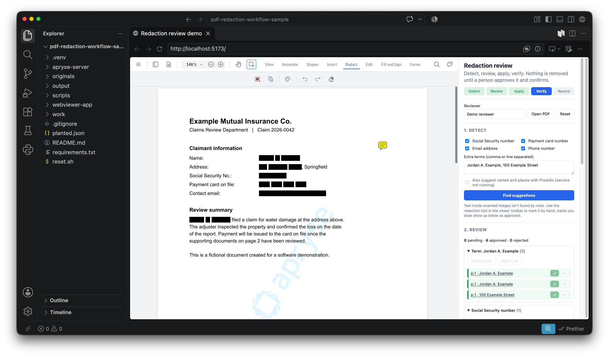

# PDF redaction workflow sample: detect, review, apply, verify

Sample code for a video about doing PDF redaction properly. It finds sensitive text, makes a person review every suggestion, applies only the approved redactions, and checks what is left. It uses Apryse WebViewer in a React app, a separate Node script that uses the Apryse Server SDK for hidden-data cleanup, a Python checker, and an open-source pipeline (Presidio and PyMuPDF) for comparison.

Find the accompanying video to this repo and more at Apryse's [YouTube Channel](https://www.youtube.com/@apryse-solutions)

**This is a tutorial sample, not a production system.** The detection rules, review screen, audit log and checker are sample code written for the video. They are not Apryse SDK features. All sample data is fictional.



## What is here

| Path                                                                  | What it is                                                                                                                         |
| --------------------------------------------------------------------- | ---------------------------------------------------------------------------------------------------------------------------------- |
| `webviewer-app/`                                                      | React and Vite app on Apryse WebViewer: find suggestions, review, apply, re-scan, download, audit log. Has its own README.         |
| `apryse-server/`                                                      | Node script using the Apryse Server SDK. The `sanitize` command removes hidden data. Has its own README.                           |
| `scripts/verify.py`                                                   | Python checker. Looks for the planted items in six places.                                                                         |
| `scripts/oss_pipeline.py`                                             | The open-source pipeline (Presidio, PyMuPDF, Tesseract), one option at a time.                                                     |
| `originals/`                                                          | The fictional claim PDF (page 1 text, page 2 scanned image, metadata, a comment, an attachment), and a copy with black boxes only. |
| `planted.json`                                                        | The 10 planted fake items.                                                                                                         |
| `scripts/presidio_service.py`                                         | Optional local Presidio service for the app.                                                                                       |
| `scripts/standin_endpoint.py`                                         | A stand-in endpoint for the app's Send button.                                                                                     |
| `scripts/make_sample.py`, `scripts/make_black_box_pdf.py`, `reset.sh` | Rebuild the sample files, and clear generated output.                                                                              |

## Quick start

Run these without the comment lines, since some shells treat `#` as part of the command.

### 1. Python: the checker and the open-source pipeline

You need Python 3.10 or newer (3.12 recommended), poppler and Tesseract. On macOS: `brew install poppler tesseract`.

```
python3.12 -m venv .venv
source .venv/bin/activate
python -m pip install -r requirements.txt
python -m spacy download en_core_web_lg
python scripts/verify.py originals/sample_claim.pdf
```

The last line should read `10 of 10 checks still recoverable.` If you only want the checker, `python -m pip install pikepdf` is enough. The rest is for the open-source pipeline.

### 2. The WebViewer app

You need an Apryse WebViewer SDK key, available for free in the [Apryse docs](https://dev.apryse.com/).

```
cd webviewer-app
npm install
cp .env.example .env.local
npm run dev
```

Add your key to `VITE_APRYSE_WEBVIEWER_KEY` in `.env.local`, then open http://localhost:5173.

### 3. The Server SDK script (optional)

You need an Apryse Server SDK key, also available for free in the [Apryse docs](https://dev.apryse.com/).

```
cd apryse-server
npm install
cp .env.example .env
```

Add your key to `APRYSE_SERVER_KEY` in `.env`. See `apryse-server/README.md` for the commands.

## The workflow

1. **Detect.** Rules find candidate text and draw a redaction mark on each match. Nothing is removed yet.
2. **Review.** A person approves or rejects every suggestion, and draws marks by hand on the scanned page, where the rules can't read text.
3. **Apply.** Only the approved marks are applied, after a confirmation.
4. **Verify.** The app re-scans its own text, and a separate checker, `verify.py`, looks in six places: the text layer, OCR of the rendered pages, metadata, comments, embedded files and the raw file bytes.
5. **Record.** An in-memory audit log of who decided what. It never stores the matched text. It is exportable, and it is not an authenticated audit system.

## Results observed on this one sample

The checker reports how many of the 10 planted items it can still find. These are limited checks on one sample file, not proof that a PDF contains no sensitive information.

| Run                                                                      | Planted items still found                                                              |
| ------------------------------------------------------------------------ | -------------------------------------------------------------------------------------- |
| The original file                                                        | 10 of 10                                                                               |
| Browser app, text marks only (no marks on the scan), hidden-data box off | 6 of 10                                                                                |
| Browser app, text marks and both scan marks, hidden-data box off         | 5 of 10 (title, author, comment, embedded file, and the name through the author field) |
| That file after the Server SDK `sanitize` command                        | 0 of 10                                                                                |

The open-source pipeline on the same file, one change at a time:

| Run                                                   | Command                                                                          | Still found |
| ----------------------------------------------------- | -------------------------------------------------------------------------------- | ----------- |
| Detect only                                           | `python scripts/oss_pipeline.py originals/sample_claim.pdf --detect-only`        | 10 of 10    |
| Apply redactions                                      | `python scripts/oss_pipeline.py originals/sample_claim.pdf output/oss_plain.pdf` | 7 of 10     |
| Scrub metadata and attachments                        | add `--scrub`                                                                    | 5 of 10     |
| OCR the scanned page first                            | add `--scrub --ocr`                                                              | 2 of 10     |
| Delete the comment, add a rule for the street address | add `--scrub --ocr --drop-annotations --term "100 Example Street"`               | 0 of 10     |

Run `python scripts/verify.py` on each output to see the count. These numbers come from one sample file and the versions listed in `requirements.txt`. They are not a benchmark. Re-run them on your own versions.

## What was tested, and what was not

**Tested:** the app's full flow in a headless browser run (WebViewer 12.2.1) and by hand in November 2026, and the app's unit tests. The Server SDK `sanitize` command ran once on this sample with a trial key in demo mode, and the saved copy carried a watermark. The Send button was checked against the stand-in endpoint with curl.

**Not tested:**

- The Server SDK script's `detect` and `apply` commands.
- The sanitizer's options for form data, occluded text and search indexes, which the script does not turn on.
- Licensed (non-trial) behavior.
- The Presidio checkbox against a running service, in the browser.
- Other documents. The sample is one fictional PDF.

Apryse documents hidden-data cleanup as sanitization for the Server SDK. The browser app has a checkbox for it that is **off by default** and experimental.

## Keys and licenses

- Apryse WebViewer and the Apryse Server SDK need a key. Do not commit keys. `.env.local` is ignored by git.
- PyMuPDF is released under the AGPL or a commercial license from Artifex. Check the current terms before you use it in a product.
- A demo can't establish production reliability. Check licensing and deployment requirements for your own use case, and test against your own requirements.
